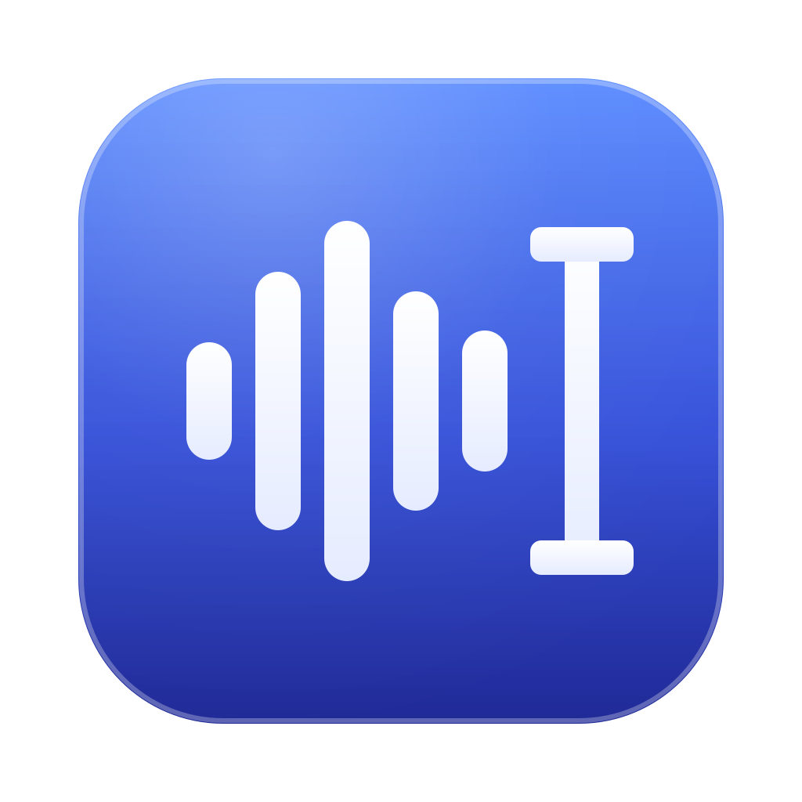

# Dictate

Push-to-talk dictation for macOS that keeps your voice on your Mac.

Hold a key, speak, release. The audio is transcribed locally by [whisper.cpp](https://github.com/ggml-org/whisper.cpp), optionally cleaned up by Claude (text only, with your own API key), and pasted at the cursor in whatever app is in front. English and German are detected automatically; whisper's multilingual model handles other languages too. A free, open alternative to cloud dictation tools, with no account and no per-use cost.

<p></p>

## How it works

1. Hold **Right Option (⌥)** and speak. A small pill at the bottom of the screen says "Listening".
2. Release. The pill shows "Transcribing…", then "Formatting…" if cleanup is on.
3. The text is pasted into the focused field, ending with a full stop and a space. Your previous clipboard is restored 0.4 s later.

Measured on an M4 Max with the `large-v3-turbo` model and the engine warm, from key release to text:

| Clip | Transcribe (local) | Cleanup (Claude Haiku) | Total |
|---|---|---|---|
| 4.5 s English | 0.56 s | 1.1-1.5 s | 1.7-2.1 s |
| 2.9 s German | 0.57 s | 1.2 s | 1.7 s |
| 21.7 s English with filler words | 0.70 s | 2.2 s | 2.9 s |
| Any clip, cleanup off | 0.56-0.70 s | - | 0.6-0.7 s |

## Requirements

- Apple Silicon Mac (the build targets arm64 and whisper.cpp uses Metal).
- macOS 13 or later is what the code compiles for; tested on macOS 26 only, untested below that.
- Xcode, or just the Command Line Tools: `xcode-select --install`.
- [Homebrew](https://brew.sh) for whisper.cpp.
- Optional: an [Anthropic API key](https://console.anthropic.com/) for the cleanup pass. Without one, leave cleanup off and the raw transcript is inserted.

## Install

```sh
# 1. speech engine + model (about 1.6 GB, one-off download)
brew install whisper-cpp
mkdir -p ~/.cache/whisper
curl -L -o ~/.cache/whisper/ggml-large-v3-turbo.bin \
  https://huggingface.co/ggerganov/whisper.cpp/resolve/main/ggml-large-v3-turbo.bin

# 2. build and install the app to ~/Applications
git clone https://github.com/parker-ai-team/dictate.git
cd dictate
scripts/build.sh
```

`build.sh` compiles with `swiftc`, assembles `Dictate.app`, signs it ad-hoc, installs it to `~/Applications` and launches it. A menu-bar icon appears; there is no Dock icon and no window.

Smaller or different models work too (any `ggml-*.bin` from the same Hugging Face repo). Set the path in Settings. The `.en` models only understand English.

## First run and permissions

macOS asks for two permissions. Both are needed.

1. **Accessibility** - to see the hotkey and to paste. System Settings > Privacy & Security > Accessibility > enable Dictate. If it is not listed, click **+** and pick `~/Applications/Dictate.app`. The app picks the grant up within two seconds; no relaunch needed.
2. **Microphone** - asked the first time you hold the hotkey. Allow, then hold and speak again.

Because the app is signed ad-hoc and not notarised, Gatekeeper may say it "cannot be opened". You built it yourself, so: right-click the app > Open > Open, or allow it under System Settings > Privacy & Security. If you want the permissions to survive rebuilds, use a real signing identity (see *Rebuilding*).

If the hotkey never reacts with Accessibility granted, also add Dictate under Privacy & Security > Input Monitoring and relaunch.

## Hotkeys and modes

Menu-bar icon > Settings…

- Keys: Right Option (default), Left Option, Right Command, Right Control, Fn/Globe.
- Modes: **Hold to talk** (default) or **Tap to start, tap to stop**.
- The menu item "Start dictation" works without the key, in both modes.
- Start/stop sounds can be switched off.

Fn/Globe works, with two conditions: System Settings > Keyboard > "Press 🌐 key to" must be **Do Nothing**, and no other tool may be using Fn. Dictate swallows the Fn event so macOS does not also open the emoji picker. Some third-party keyboards and remappers do not send Fn as key code 63; pick another key then.

## Settings

- **Cleanup**: on = Claude removes filler words, fixes punctuation and capitalisation, formats obvious lists. It never adds content; output longer than the input is rejected and the raw transcript is used. Off = raw whisper transcript. On an API error or timeout the raw transcript is inserted, never nothing.
- **Model**: `claude-haiku-5-5` by default; any Anthropic model id.
- **Timeout**: base 2 s, growing by 1 s per 400 characters of transcript, capped at base + 4 s.
- **API key**: paste once, "Save to Keychain". Stored in the macOS login keychain (see [SECURITY.md](SECURITY.md)).
- **Speech engine**: paths to `whisper-server` and the model, port (localhost only). "Restart engine" reloads the model.
- **Launch at login**: standard macOS login item.

## Privacy

- Audio never leaves the Mac. whisper-server listens on 127.0.0.1 only and is started and stopped by the app.
- With cleanup on, the only outbound connection is `api.anthropic.com:443`, carrying the transcript text. With cleanup off there is no network connection at all.
- The log (`~/Library/Logs/Dictate.log`) holds timings and character counts, not text.
- Insertion goes through the clipboard for 0.4 s. The item is marked transient and concealed (nspasteboard.org convention) so clipboard managers that honour it skip it; tools that do not, or Universal Clipboard, may still see the text in that window. Details in [SECURITY.md](SECURITY.md), including who can read the stored API key.

Spot-check it: `scripts/make-test-clips.sh` once, then `scripts/verify.sh test/en_short.wav` (and `--no-format`). The script samples the sockets of the app and of whisper-server every 50 ms during the run and prints the remote endpoints it saw. A packet capture gives the complete picture.

## Rebuilding and signing

```sh
scripts/build.sh              # build, install, relaunch
scripts/build.sh --no-install # just build/Dictate.app
scripts/make-icon.sh          # regenerate the icon assets from Icon/*.svg
```

Ad-hoc signatures change with every build, and macOS ties the Microphone and Accessibility grants to the signature, so after a rebuild you may have to toggle Dictate off and on under Accessibility. To avoid that, sign with a stable identity:

- your own Apple Development certificate: `DICTATE_SIGN_IDENTITY="Apple Development: you@example.com (TEAMID)" scripts/build.sh`
- or a free self-signed one: `scripts/make-signing-cert.sh`, then build with `DICTATE_SIGN_IDENTITY="Dictate Dev"` and `DICTATE_SIGN_KEYCHAIN=~/Library/Keychains/dictate-signing.keychain-db`.

`DICTATE_BUNDLE_ID` changes the bundle id (default `com.parkeraiteam.dictate`); it also names the keychain item and the preferences domain.

## Known limits

- The hotkey is a modifier key. If you type special characters with Right Option, every such press starts a recording; use Left Option for typing or pick another key.
- Pasting into existing text that ends without a space joins directly. Consecutive dictations are fine because each ends with a space.
- Insertion needs a field that accepts Cmd+V. Terminals that remap paste, and some custom editors, will not take it.
- No streaming: text arrives after you release the key. The cleanup pass is 1-2 s of that; a local formatter can be added behind the `TextFormatter` protocol.
- Clips under 0.35 s are ignored. Silence inserts nothing.
- If the app is force-killed, its whisper-server child keeps running (about 1.6 GB RAM). The next launch reuses it; Quit from the menu stops it; or `pkill whisper-server`.
- Port reuse: if any whisper server already answers on the configured port (default 8178), the app uses it instead of starting its own, including one you started with `--host 0.0.0.0`. The "localhost only" guarantee holds for the server the app starts itself. Change the port in Settings if something else lives there.
- The optional `scripts/make-signing-cert.sh` adds a self-signed code-signing root to your user trust settings and a never-locking keychain; its header says exactly what and how to remove it.
- Tested on one machine (M4 Max, macOS 26). Reports from other setups are welcome.

## Project layout

```
Sources/
  main.swift                 entry; headless --selftest and --version (--insert / --hotkey-test only in --debug builds)
  AppDelegate.swift          menu bar, permission polling, wiring
  DictationController.swift  hotkey -> mic -> whisper -> cleanup -> paste
  HotkeyMonitor.swift        CGEvent tap on flagsChanged (modifier keys, Fn)
  AudioRecorder.swift        AVAudioEngine, 16 kHz mono, WAV encoding
  WhisperServer.swift        whisper-server child process + HTTP client
  Formatter.swift            TextFormatter protocol, ClaudeFormatter, PassthroughFormatter
  TextInserter.swift         pasteboard paste + restore, terminal punctuation
  Keychain.swift             API key via /usr/bin/security
  Permissions.swift          microphone + accessibility checks and deep links
  Indicator.swift            floating status pill
  SettingsWindow.swift       SwiftUI settings
Icon/                        SVG sources and the SVG rasteriser
scripts/                     build.sh, make-icon.sh, make-signing-cert.sh, make-test-clips.sh, verify.sh
```

## License

MIT, see [LICENSE](LICENSE). whisper.cpp is MIT-licensed and installed separately; the whisper models are released by OpenAI under MIT.
